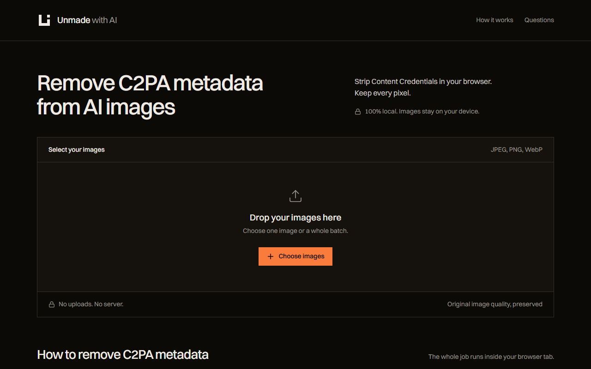
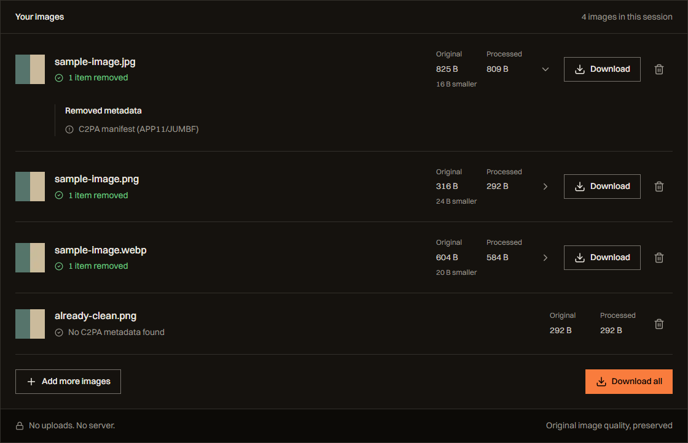
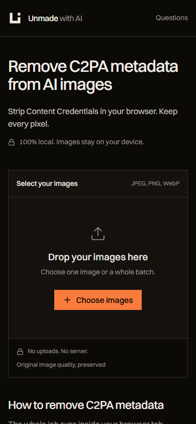

<p align="center">
  
</p>

<p align="center">
  <strong>Your images. Without the provenance metadata.</strong><br />
  A small browser tool for removing C2PA Content Credentials from JPEG, PNG and WebP images.
</p>

<p align="center">
  <a href="https://github.com/husnain381a/unmade-with-ai/actions/workflows/ci.yml"></a>
  <a href="LICENSE"></a>
  <a href="https://react.dev/"></a>
  <a href="https://www.typescriptlang.org/"></a>
</p>

<p align="center">
  <a href="https://unmadeai.husnain.website">Open the app</a>&nbsp;&nbsp; / &nbsp;&nbsp;
  <a href="#quick-start">Quick start</a>&nbsp;&nbsp; / &nbsp;&nbsp;
  <a href="docs/DEPLOYMENT.md">Self-hosting</a>&nbsp;&nbsp; / &nbsp;&nbsp;
  <a href="CONTRIBUTING.md">Contribute</a>
</p>



## What it does

Unmade with AI reads an image's file container, removes recognized C2PA provenance metadata, and produces a downloadable file. The encoded image data is preserved without re-encoding. Image processing runs on your device; no account or image upload is required.

| Capability | Details |
| --- | --- |
| Local processing | Files are read in browser memory using the File, Blob and ArrayBuffer APIs. |
| Batch selection | Drop several images or choose them from the file picker. |
| Per-file results | See a preview, removed metadata, and original and processed byte sizes. |
| Downloads | Save each processed file or use Download all for a batch. Filenames receive an `unmade-` prefix. |
| Clear feedback | Clean files, unsupported formats and parsing errors have distinct messages. |
| Responsive interface | Keyboard focus, reduced-motion support, mobile layouts, and expandable reference answers. |

## A look at the results



Captured from the running app using synthetic image fixtures. The numbers shown are the actual results for those sample files.

<details>
  <summary><strong>See the mobile workspace</strong></summary>
  <p align="center">
    
  </p>
</details>

## Quick start

For local development, use **Node.js 22 or later** and npm. No environment variables, API keys or backend setup are required.

```sh
git clone https://github.com/husnain381a/unmade-with-ai.git
cd unmade-with-ai
npm ci
npm run dev
```

Open the local URL printed by Vite, usually [http://localhost:5173](http://localhost:5173).

To build and preview the production site:

```sh
npm run build
npm run preview
```

Vite writes the deployable site to `dist/`. See the [deployment guide](docs/DEPLOYMENT.md) for Vercel and other static hosts.

## How it works

1. **Select images.** Add JPEG, PNG or WebP files through drag-and-drop or the file picker.
2. **Inspect the container.** The browser removes the recognized provenance segments and updates container lengths where needed.
3. **Review and download.** Check the removed items and size changes, then save the result. Files without recognized C2PA metadata are marked as clean.

| Format | Metadata targeted |
| --- | --- |
| JPEG | APP11/JUMBF segments and XMP or extended XMP segments referencing C2PA. |
| PNG | `caBX` and `c2pa` chunks, plus text chunks whose keywords and content reference C2PA provenance. |
| WebP | `C2PA` chunks and XMP chunks referencing C2PA; the RIFF length is updated afterward. |

GIF, HEIC and AVIF are not currently supported. The parser lives in [`src/utils/c2pa-remover.ts`](src/utils/c2pa-remover.ts).

## Privacy and scope

- Image bytes are processed locally. The app does not upload, retain or log selected files.
- The static page and its assets still come from the site host. Switzer fonts load from Fontshare, with system font fallbacks.
- Processing can continue after the page has loaded if the connection is lost. There is no service worker or guaranteed cold-start offline cache.
- This is a C2PA provenance remover, not a general-purpose metadata scrubber. Unrelated EXIF, location data and other metadata may remain.
- It does not remove visible watermarks or other signals embedded in pixels, and it cannot guarantee how a platform labels an image.

## Development

| Command | Purpose |
| --- | --- |
| `npm run dev` | Start the Vite development server. |
| `npm run lint` | Run ESLint. |
| `npm run typecheck` | Check the application with TypeScript. |
| `npm run build` | Create the production bundle in `dist/`. |
| `npm run preview` | Serve the production build locally. |

GitHub Actions runs lint, type checking and the production build for pushes to `main` and pull requests. See [CONTRIBUTING.md](CONTRIBUTING.md) for the contribution workflow and image-fixture guidance.

## Project structure

```text
src/
  App.tsx                  Image workspace, file results and reference sections
  content/site.ts          Shared copy, site metadata and structured-data builders
  utils/c2pa-remover.ts    Container parsing and metadata removal
  tokens.css               Color, type, spacing and motion tokens
  base.css                 Shared accessibility and layout foundations
  index.css                Application styling and hosted font declarations
public/                    Logo, icons, manifest, robots.txt and sitemap
docs/                      Deployment guide and product screenshots
.github/workflows/ci.yml   Automated project checks
vite.config.ts             Static structured-data and no-JavaScript HTML injection
```

The shared content module feeds both React and the generated static HTML, keeping FAQ text, structured data and the no-JavaScript reference content synchronized. JavaScript is required to process images.

## Credits and licensing

Created by [Husnain Mazhar](https://husnainmazhar.com).

Built with [React](https://react.dev/), [TypeScript](https://www.typescriptlang.org/), [Vite](https://vite.dev/), [Tailwind CSS](https://tailwindcss.com/), and [Lucide](https://lucide.dev/). Typography uses [Switzer by Fontshare](https://www.fontshare.com/fonts/switzer); font binaries are not redistributed in this repository. See the [font notes](public/fonts/README.md) and included [third-party font license](public/fonts/Switzer-FFL.txt).

Released under the [MIT License](LICENSE). Third-party assets and dependencies retain their respective licenses.
